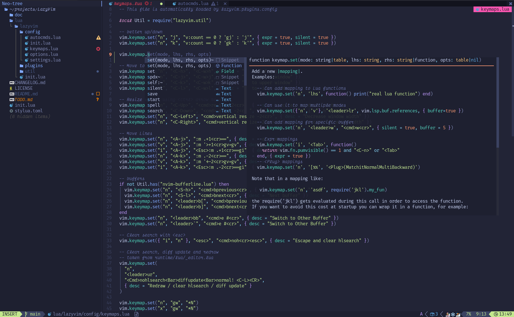

# LazyVim-Inspired Portfolio

An interactive, terminal-styled developer portfolio built with React, TypeScript, and Vite. Designed around the **LazyVim / NeoVim** aesthetic, this site functions as an interactive workspace where visitors can explore project code, documentation, and live embedded web apps using either keyboard shortcuts or mouse navigation.

 *(optional preview image)*

---

## Features

- **TUI/LazyVim UI:** Buffer tabs, file tree navigation (`Neo-Tree`), statusline (`Lualine`), and command palette search.
- **Embedded Project Viewports:** Sandboxed live previews of independent web projects integrated seamlessly alongside code snippets and Markdown case studies.
- **Dual Controls:** Full mouse accessibility paired with Vim keyboard navigation.
- **Tokyo Night Aesthetic:** Dark-mode TUI interface styled with custom Tailwind themes and JetBrains Mono typography.

---

## Tech Stack

- **Framework:** [React 19](https://react.dev/) + [Vite](https://vite.dev/)
- **Language:** [TypeScript](https://www.typescriptlang.org/)
- **Styling:** [Tailwind CSS v4](https://tailwindcss.com/)
- **Icons:** [Lucide React](https://lucide.dev/)
- **Typography:** JetBrains Mono

---

## Navigation Shortcuts

| Keybinding | Action |
| :--- | :--- |
| `j` / `k` | Scroll down / up through active buffer |
| `<Space> + f` | Open Telescope quick-search command menu |
| `Tab` / `Shift + Tab` | Cycle forward / backward through open tabs |
| `Esc` | Close floating modals or exit focused iframe |

---

## Local Development Setup

Clone the repository and run the development server locally:

\`\`\`bash
# 1. Clone repo
git clone https://github.com/your-username/portfolio.git
cd portfolio

# 2. Install dependencies
npm install

# 3. Start development server
npm run dev
\`\`\`

Open [http://localhost:5173](http://localhost:5173) in your browser to view the application.